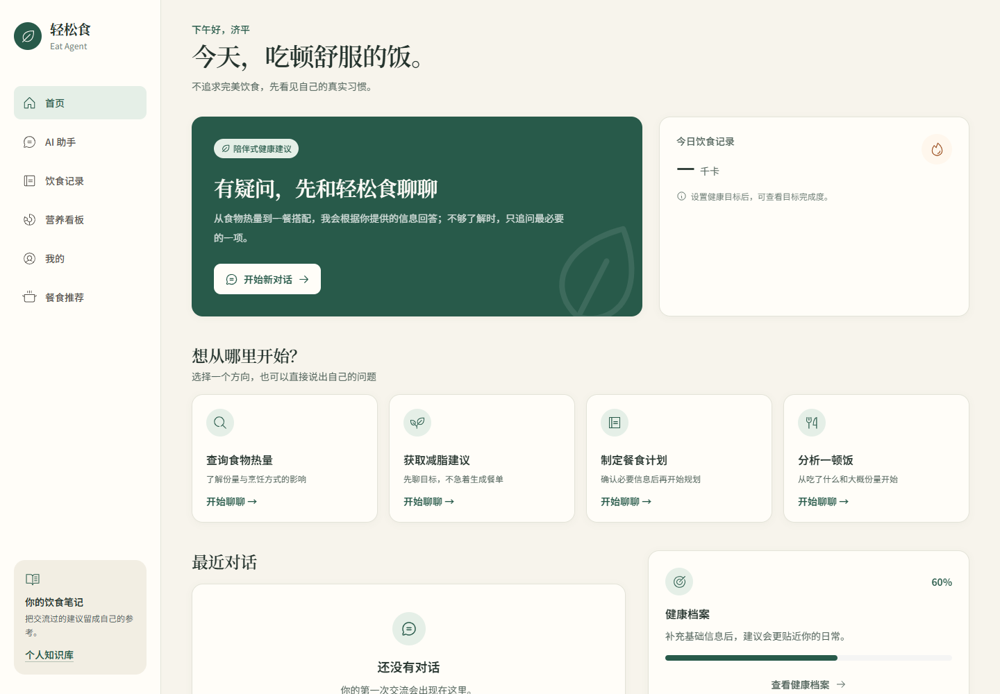
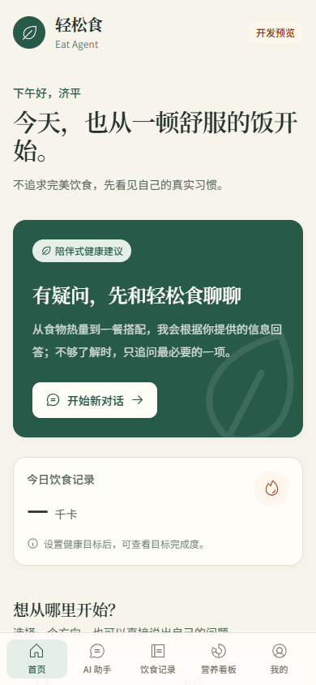
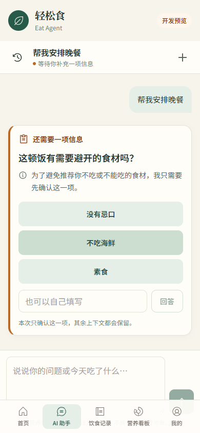
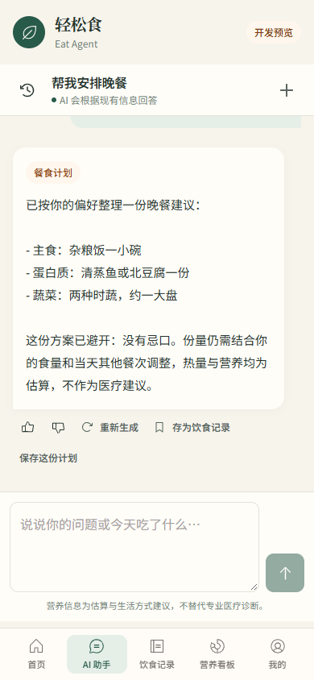
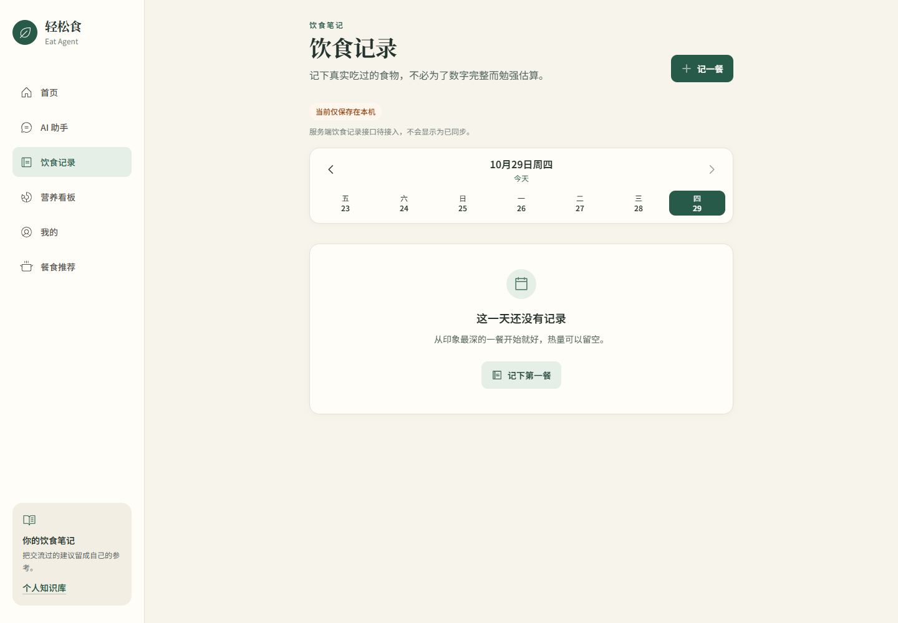

# 轻松食 · Nutrition Agent

> 面向个人与小众平台的 Agentic RAG 智能营养助手。它会先判断用户想做什么，再检查完成任务所需的信息是否齐全；信息不足时主动追问，信息满足后才进入检索、工具调用和回答生成。

[](https://github.com/jiping730/nutrition-agent/actions/workflows/ci.yml)
[](https://www.python.org/)
[](frontend/)

<div align="center">
  
</div>

<p align="center"><em>先理解问题，再在信息足够时给出营养建议。</em></p>

## 项目定位

这是一个可运行、可测试、可解释的营养问答 Agent 项目，不是只展示 Prompt 的 Demo。

- **统一 Agent 主链路**：CLI、API 和 Web 都通过同一个 ConversationRuntime → LangGraph Workflow 执行。
- **通用追问引擎 Grill**：按任务画像定义必需字段、字段校验和确认门禁，避免信息不完整时过早执行。
- **本地 Agentic RAG**：FAISS 向量召回与词法召回融合，支持查询改写、确定性重排、权限过滤和来源追溯。
- **单端口 Web 应用**：FastAPI 提供 API，并托管移动端优先的 React 前端，生产访问统一使用 5000 端口。
- **小型平台边界**：支持 JWT、会话持久化、基础多租户、个人档案、个人知识库和 Docker Compose；不以万人级分布式平台为目标。

## 核心能力

| 模块 | 当前实现 |
| --- | --- |
| Agent 工作流 | LangGraph 状态图、意图识别、记忆/档案、Grill 校验、Tool Registry、答案生成与安全校验 |
| Grill 追问 | 任务画像、字段类型与依赖、否定/拒答识别、换题、多任务顺序队列、确认后执行、结构化决策输出 |
| RAG | 文档清洗与版本化入库、FAISS + 词法多路召回、查询改写、轻量确定性重排、来源与证据片段追溯 |
| 模型与工具 | LiteLLM 模型网关、智谱兼容中转站、超时/重试/预算、MCP 本地工具、工具权限与审计 |
| 平台能力 | FastAPI、JWT/API Key、会话与用户隔离、基础租户角色、个人档案、个人知识库、SSE 流式对话 |
| 质量保障 | 82 条确定性评测用例、RAG/Grill/安全指标、pytest 覆盖率门禁、Ruff/Black/isort/Mypy、Playwright E2E、Helm 静态校验 |

## 产品体验

截图来自当前 React 前端的真实页面，覆盖从进入首页、主动补充信息，到生成餐食建议和记录饮食的完整路径。

<table>
  <tr>
    <td width="50%"></td>
    <td width="50%"></td>
  </tr>
  <tr>
    <td align="center"><strong>移动端首页</strong><br />快捷进入营养问答、饮食记录和目标设置</td>
    <td align="center"><strong>Grill 主动追问</strong><br />缺少关键字段时，只追问当前任务所需的信息</td>
  </tr>
  <tr>
    <td width="50%"></td>
    <td width="50%"></td>
  </tr>
  <tr>
    <td align="center"><strong>餐食计划</strong><br />信息确认后生成可解释的餐食建议</td>
    <td align="center"><strong>饮食记录</strong><br />按日期回看饮食，并为后续营养分析提供输入</td>
  </tr>
</table>

## 一次完整交互

```text
用户问题
   ↓
意图识别与任务判断
   ↓
Grill 检查任务字段
   ├─ 信息不足：返回一个必要追问，等待用户补充
   └─ 信息满足：进入检索、工具调用或直接回答
                    ↓
          来源追溯与安全校验
                    ↓
              流式输出最终答案
```

这条链路解决的是 Agent 应用中常见的“过早回答”和“盲目调用工具”问题：例如用户只说“我想减脂”，系统先给出方向性建议；只有用户明确要求制定餐食计划时，才进入餐食规划所需的信息收集。

## 技术亮点

| 关注点 | 项目做法 | 解决的问题 |
| --- | --- | --- |
| 信息完整性 | Grill 任务画像、字段校验、依赖关系、拒答/否定识别和确认门禁 | 避免信息不足时直接生成计划或调用工具 |
| 检索质量 | FAISS 向量召回 + 词法召回 + 查询改写 + 确定性重排 | 提升同义表达下的命中率，减少无关上下文 |
| Agent 工程化 | LangGraph 状态图、统一 Runtime、Tool Registry、MCP 网关 | 避免 CLI、Web 和旧入口各自维护一套 Agent |
| 可解释性 | 来源元数据、证据片段、动作决策和追问字段可追溯 | 能回答“为什么追问”和“依据来自哪里” |
| 可验证性 | 82 条评测集、RAG/Grill/安全指标、CI 质量门禁 | 每次改动都能发现关键行为回归 |

## 架构概览

~~~mermaid
flowchart LR
    U[Web / CLI / API] --> R[ConversationRuntime]
    R --> W[LangGraph Workflow]
    W --> I[Intent Router]
    W --> M[Memory & Profile]
    W --> G[Grill Engine<br/>信息完整性与追问]
    G -->|信息不足| Q[返回追问]
    G -->|信息满足| T[Tool Registry]
    T --> H[Hybrid Retriever<br/>FAISS + 词法召回 + 重排]
    T --> C[本地 MCP / 领域工具]
    H --> A[答案生成]
    C --> A
    A --> S[安全与来源校验]
    S --> P[(SQLite / PostgreSQL)]
    S --> O[流式响应 / 最终回答]
~~~

## 快速开始

### 方式一：Docker Compose（推荐）

前置条件：已安装并启动 Docker Desktop。

~~~bash
copy .env.example .env          # Windows
# cp .env.example .env          # Linux/macOS
~~~

在 .env 中至少配置模型网关所需的 Key、ANTHROPIC_API_BASE 和 JWT_SECRET。真实密钥只放在本地 .env 或部署环境，不要提交到 Git。

~~~bash
docker compose up -d --build
docker compose ps
~~~

打开 <http://127.0.0.1:5000>。常用运维命令：

~~~bash
docker compose logs -f eat-agent
docker compose restart eat-agent
docker compose down
~~~

Compose 会启动 PostgreSQL、Redis 和应用；应用启动时执行迁移检查，健康检查地址为 /healthz。

### 方式二：本地 Python + React 生产构建

~~~bash
python -m venv .venv
.venv\Scripts\activate              # Windows PowerShell
python -m pip install -r requirements.txt
copy .env.example .env
~~~

本地不启动 PostgreSQL/Redis 时，可在 .env 使用 SQLite：

~~~env
DATABASE_URL=sqlite:///data/app.db
AUTO_CREATE_SCHEMA=true
JWT_SECRET=replace-with-a-local-random-secret
LLM_MODEL=glm-5.3-flash
LLM_INTENT_MODEL=glm-5.3-flash
LLM_ANSWER_MODEL=glm-5.3-flash
~~~

构建前端并启动单端口服务：

~~~bash
cd frontend
npm ci
npm run build
cd ..
python front/app.py
~~~

访问 <http://127.0.0.1:5000>。前端开发热更新可单独运行 npm run dev，默认使用 5173，但它只是开发入口；日常使用和验收以 5000 为准。

### 模型配置

项目通过 LiteLLM 统一模型调用。当前配置可使用兼容中转站和 glm-5.3-flash：

~~~env
ANTHROPIC_API_KEY=your_relay_key
ANTHROPIC_API_BASE=https://your-compatible-relay.example/v1
LLM_PRIMARY_PROVIDER=anthropic
LLM_FALLBACK_PROVIDER=anthropic
LLM_MODEL=glm-5.3-flash
~~~

模型不可用时，项目可以进入结构化离线降级模式；这不等同于真实模型回答。前端 mock 仅在显式设置 VITE_USE_MOCK_API=true 时启用。

## 测试与评测

安装开发依赖后运行默认回归：

~~~bash
pytest -q -m "not e2e"
~~~

运行确定性评测和质量门禁：

~~~bash
python -m evaluation.runner \
  --suite all \
  --mode deterministic \
  --min-rag-recall 0.90 \
  --min-grill-accuracy 0.90 \
  --max-invalid-retrieval-rate 0.15 \
  --min-safety-pass-rate 0.90
~~~

评测输出包含 JSON 报告和控制台摘要，报告写入 evaluation/reports/latest.json。当前评测集为 **82 条**：18 条 RAG、64 条 Grill/安全与对话决策用例，覆盖 Recall@K、MRR、来源覆盖率、无效检索率、动作准确率、追问字段准确率、过早回答率、过度追问率和安全门禁。

RAGAS 是可选的手动评测能力，需要额外安装 .[eval] 并提供本地回答快照；它不进入普通 push CI，也不会自动上传真实用户对话。具体格式见 [评测说明](docs/evaluation.md)。

浏览器验收需要 Playwright 和已启动的 5000 服务：

~~~bash
python -m pip install -e ".[dev,e2e]"
python -m playwright install chromium
pytest -q -m e2e
~~~

## 项目结构

~~~text
.
├── main.py                  # CLI 入口
├── config.py                # Pydantic Settings 配置入口
├── front/                   # FastAPI 应用、认证、API 和静态文件托管
├── frontend/                # React/Vite Web 前端
├── core/                    # Workflow、Runtime、Grill、记忆、工具注册
├── agent/                   # 旧入口兼容适配器和提示/工具定义
├── rag/                     # 文档入库、FAISS、词法/向量检索与重排
├── evaluation/              # 评测集、固定语料、运行器、指标和报告
├── tests/                   # 单元、集成、安全、并发和浏览器测试
├── data/                    # 本地知识文档、索引和运行数据
├── migrations/              # Alembic 数据库迁移
├── scripts/                 # 迁移、备份、恢复、清理和运维脚本
├── deploy/                  # Helm/Kubernetes 清单（可选）
├── docs/                    # 开发主线、实施记录和专项文档
├── Dockerfile               # 前端构建 + Python 应用镜像
├── docker-compose.yml       # 本地小型平台编排
├── pyproject.toml           # 包元数据、依赖、测试和质量工具配置
└── .env.example             # 配置模板；真实 .env 不入 Git
~~~

根目录中的单独文件大多属于标准项目入口或工具配置，不需要为了“看起来整齐”而移动；测试缓存、运行数据库和临时索引均已加入忽略规则，属于本地可再生成产物。

## 文档导航

- [项目实施主线](docs/implementation-roadmap.md)：阶段优先级、完成状态和后续边界。
- [项目实施记录](docs/implementation-record.md)：已经实际完成的阶段、改动、验收和已知限制。
- [评测说明](docs/evaluation.md)：82 条评测集、指标、质量门禁和 RAGAS 手动评测。
- [前端并入记录](docs/frontend-integration.md)：React 前端、单端口托管和接口适配说明。
- [文档总览](docs/README.md)：其他阶段实施文档和专项说明入口。

## 当前边界

项目以个人长期使用和少量租户的小型平台为目标，当前明确保留以下边界：

- 默认采用单体应用和 Docker Compose；SQLite 是本地默认路线，PostgreSQL 是可选升级路线。
- Kubernetes/Helm 清单已具备并可做 lint/render 静态校验，但未宣称真实集群、Ingress、HPA 或高可用验收完成。
- RAGAS 只支持手动评测；LangSmith 当前未接入，README 不将其描述为已实现能力。
- 饮食记录的部分数据仍是本机保存，前端会明确标注“服务端接口待接入”，不会伪装成已同步。
- 暂不建设企业 SSO、复杂 RBAC、分布式任务队列、独立向量数据库、跨区域容灾或万人级多租户基础设施。

## License

MIT
